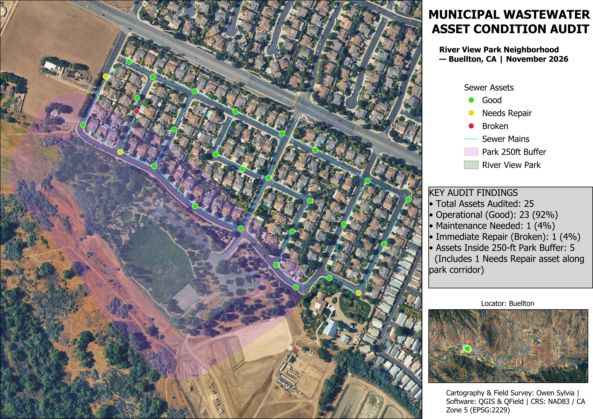

#### Municipal Wastewater Infrastructure Condition Audit — Buellton, CA

**Live Interactive Web Map:** https://owensylvia.github.io/buellton-sewer-gis-audit/ 

#### Project Overview

An end-to-end municipal GIS field data collection, spatial analysis, and web-mapping project modeling **25 wastewater assets** (manholes and storm/sewer access points) in the River View Park neighborhood of **Buellton, California**. The workflow demonstrates a complete mobile-to-cloud-to-desktop GIS pipeline designed for municipal utilities and civil infrastructure asset management. 

#### Data Transformation (Before & After)

Legacy municipal utility records often exist only as flat, non-spatial reference images. This workflow georeferenced public reference imagery into **NAD83 / California zone 5 (EPSG:2229)**, digitized snapped network geometry, and enriched each structure with field-verified geotagged photographs and conditional risk attributes. 

Before: Static Public Reference ImageAfter: Interactive Web GIS & Field Popups
****

***Un-georeferenced public utility reference map without searchable attributes or field verification.***
*Interactive Leaflet web map featuring snapped sewer mains, 250-ft park proximity buffer, and geotagged field photos.*

#### Modeled Audit Findings

* **Total Assets Inventoried:** 25 wastewater structures
* **Modeled Condition Breakdown:** 23 Good (92%), 1 Needs Repair (4%), 1 Broken (4%)
* **Environmental Proximity Risk:** 5 assets fall within a **250-foot buffer** of River View Park, including 1 modeled *Needs Repair* asset flagged for preventative maintenance along the public park corridor.

#### Technical Workflow & Methodology

1. **Baseline Digitization & Georeferencing (QGIS):** Georeferenced municipal utility reference imagery over high-resolution aerial basemaps in **NAD83 / California zone 5 (EPSG:2229, US Survey Feet)** and structured a relational **GeoPackage (.gpkg)** schema.
2. **Mobile Field Data Collection (QField & QFieldCloud):** Configured constrained **Value Map** attribute domains (Asset Type, Condition), automated relative-path photo attachments (DCIM/), and bi-directional cloud synchronization for field verification on iOS.
3. **Database Hygiene & Spatial Analysis:** 

  * Standardized attribute schemas and automated maintenance prioritization (Immediate Repair, Schedule Maintenance, Routine Monitoring) using SQL CASE expressions in the QGIS Field Calculator.
  * Built snapped **Sewer Mains** network topology (LineString) connecting assets along street centerlines.
  * Executed a **250-foot survey-foot proximity buffer** and spatial intersection query around River View Park to flag environmentally sensitive assets.
4. **Cartography & Web Publishing:** Designed an 11" × 17" (ANSI B) engineering print layout PDF and published an interactive **Leaflet** web map with clickable geotagged field photos via **qgis2web** and **GitHub Pages**.

#### Tools & Technologies

* **Desktop GIS:** QGIS 3, Field Calculator, Processing Toolbox (Buffer, Select by Location, Reproject Layer, Refactor Fields)
* **Mobile & Cloud GIS:** QField (iOS), QFieldSync, QFieldCloud
* **Data Format & CRS:** OGC GeoPackage (.gpkg), EPSG:2229 (NAD83 / California zone 5 ftUS)
* **Web Mapping:** qgis2web, Leaflet, HTML/CSS/JavaScript, GitHub Pages

#### Repository Contents

* index.html — Main interactive Leaflet web map entry point
* data/ — Exported GeoJSON layers (Sewer_Assets, Sewer_Mains, Park_250ft_Buffer, River_View_Park)
* images/ — Optimized geotagged field inspection photographs linked to asset popups
* css/, js/, legend/, markers/ — Leaflet map styling, layer controls, and symbology assets

**Data Disclaimer:** *Asset locations and field photographs were collected on-site in Buellton, CA as part of an independent academic/portfolio GIS workflow. Condition ratings ("Needs Repair" and "Broken") were simulated on two assets to demonstrate conditional symbology, SQL risk-scoring logic, and spatial buffer prioritization; they do not represent an official municipal engineering inspection.*
